# Kotilo Deck

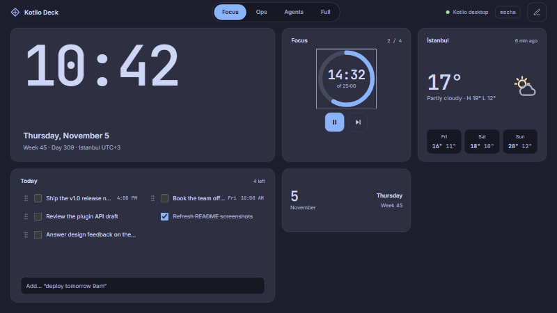

A full-screen developer dashboard for your second display. Kotilo Deck keeps the things you glance at all day on a small screen next to your main monitor: clock, weather, calendar, system load, media, volume, a pomodoro timer, todos and your AI agents. Arrange them on a snap-to-grid layout, save layouts as workspaces, and match them to the colour theme you already use in your editor. Part of [Kotilo](https://kotilo.dev); free and open source (MIT).

## Features

- **Ten widgets**: Clock (time zones, analog/digital), Date, Weather (Open-Meteo, no API key), Calendar (ICS feeds, countdown to the next event), System (CPU per core, RAM, GPU, 60 s sparkline, top processes), Volume (output device, per-app mixer), Media (artwork, controls, progress), Pomodoro (daily goal ring, notifications), Todo (quick add like `deploy tomorrow 9am`, reminders) and Agent Status.
- **Workspaces**: saved dashboards (Focus, Ops, Agents, Full presets) with their own layout and theme. Switch with a swipe, the top bar, `Ctrl+Alt+←/→`, the tray, or auto-switch rules (time of day, pomodoro start, calendar event).
- **Android-style grid**: 8×4 landscape, 4×8 portrait, adjustable density; each widget has a few fixed sizes with a layout per size.
- **31 themes**: Catppuccin, Tokyo Night, Nord, Dracula, Gruvbox, Rosé Pine, Solarized, GitHub, One Dark and more, plus your own JSON themes. Light/dark auto switch, wallpapers, transparency and blur, and a frosted glass look over a wallpaper.
- **Companion for Kotilo desktop**: see running agents, approve or deny pending actions from the deck, focus suggestions for the pomodoro timer ([protocol](protocol.md)).
- **Tablet / LAN mode**: open the deck in any browser on your network (old tablet, phone) by scanning a QR code; token protected.
- **Widget plugins**: drop an HTML widget into `~/.kotilo/deck/widgets/` ([plugin API](docs/plugin-api.md)).
- **Auto-update**: signed updates, checked daily, installed only when you click.
- **Burn-in protection**: pixel shift, night dim schedule, idle dim with a screensaver clock.
- Touch first (44 px targets), fully keyboard usable, English and Turkish UI.

## Screenshots

| Catppuccin Mocha | Tokyo Night |
|---|---|
| 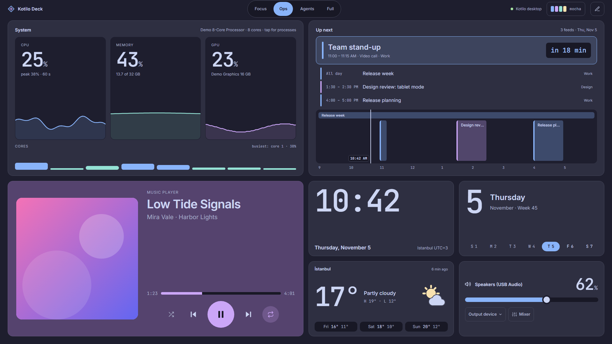 | 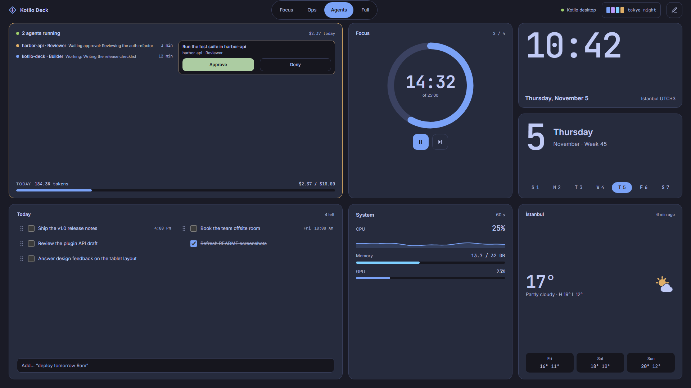 |
| **Nord** | **Catppuccin Latte** |
| 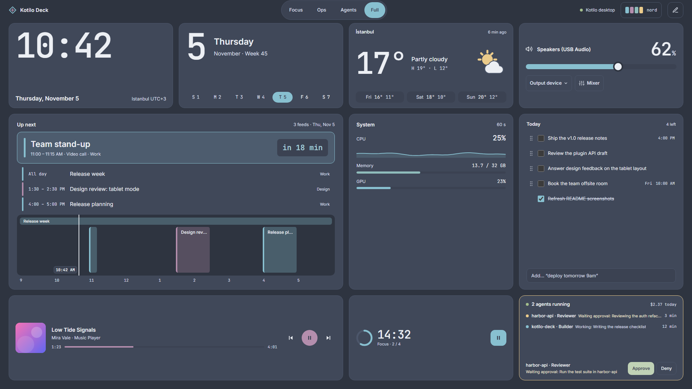 | 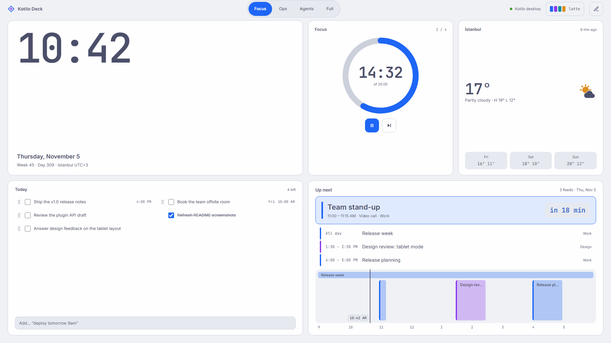 |
| **Glass look (Ops)** | **Glass look (Focus)** |
| 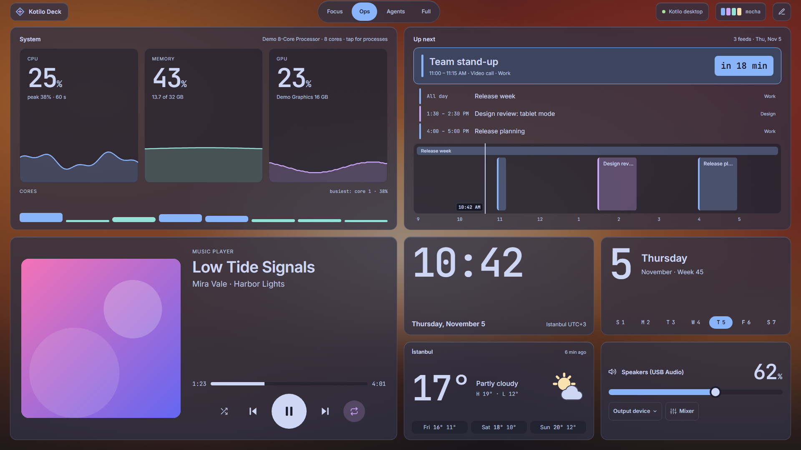 | 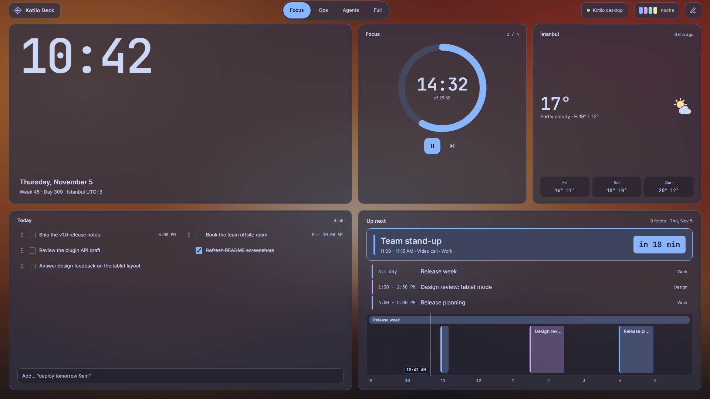 |

Edit mode, a 7" 1024×600 display, and portrait (4×8):

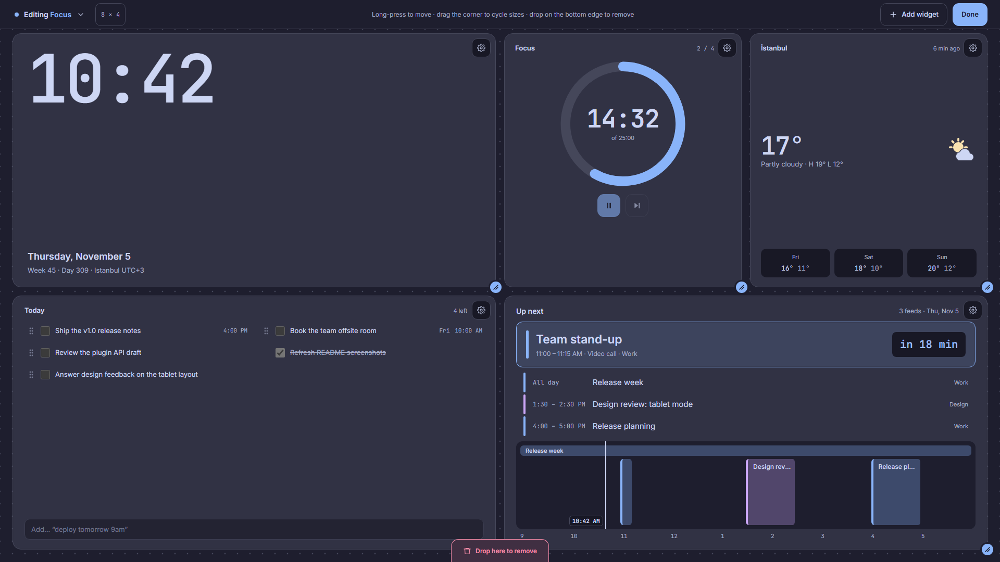


| 7" landscape | Portrait |
|---|---|
| 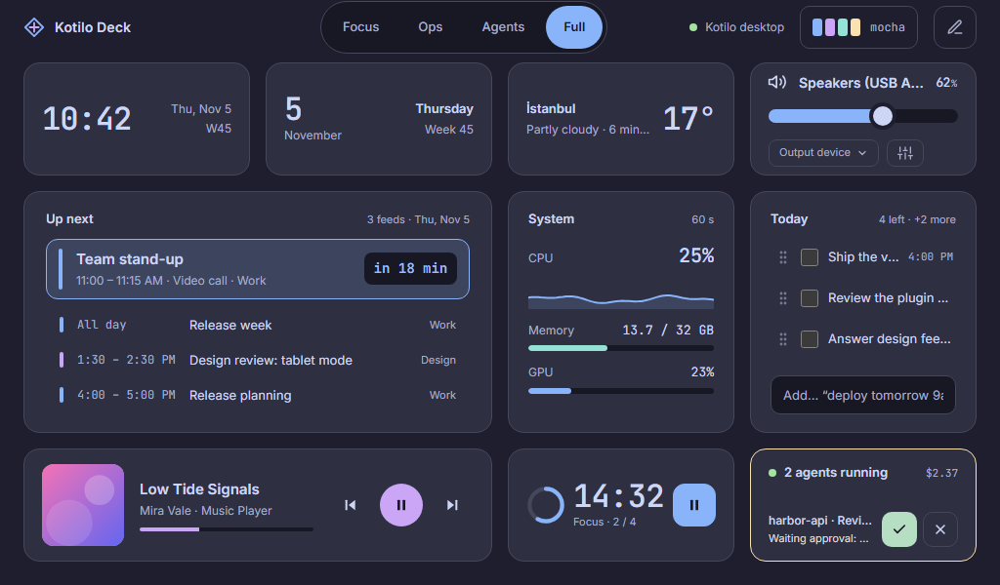 | 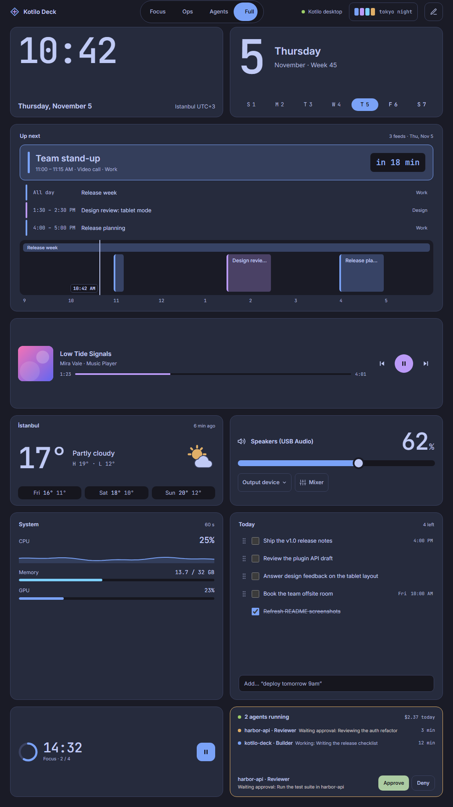 |

### Widgets

| Widget | | Widget | |
|---|---|---|---|
| Clock | 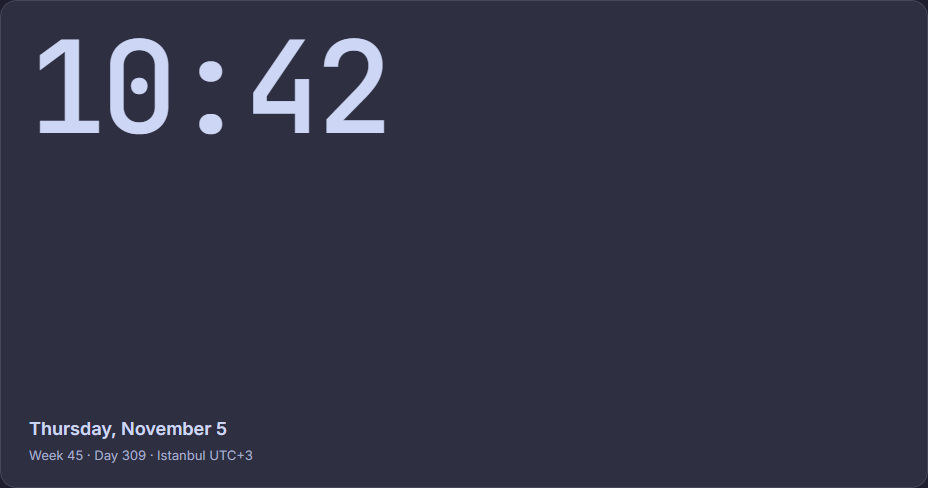 | Calendar | 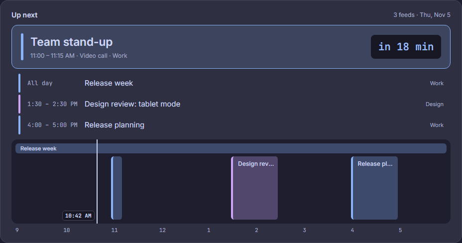 |
| Weather | 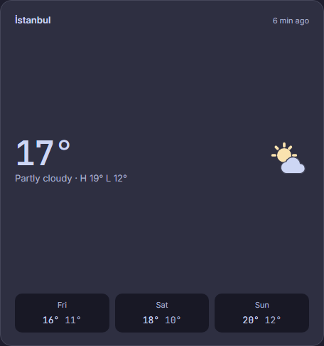 | System | 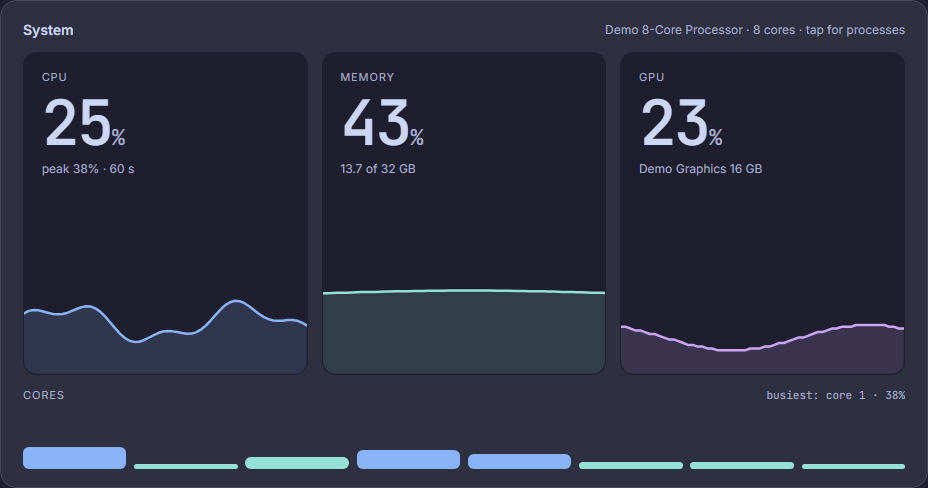 |
| Pomodoro | 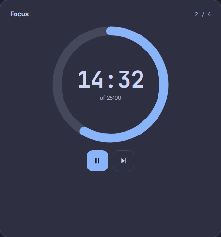 | Media | 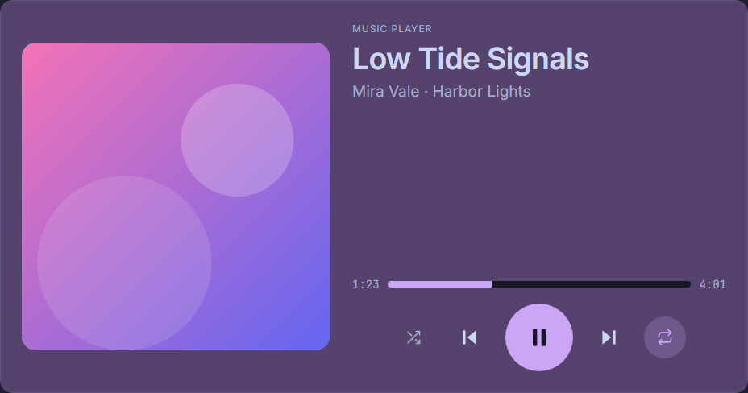 |
| Todo | 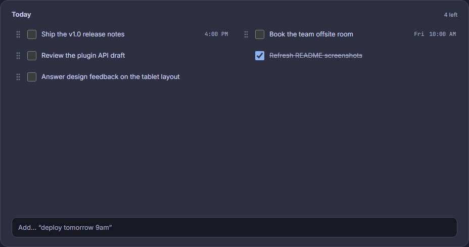 | Agent Status | 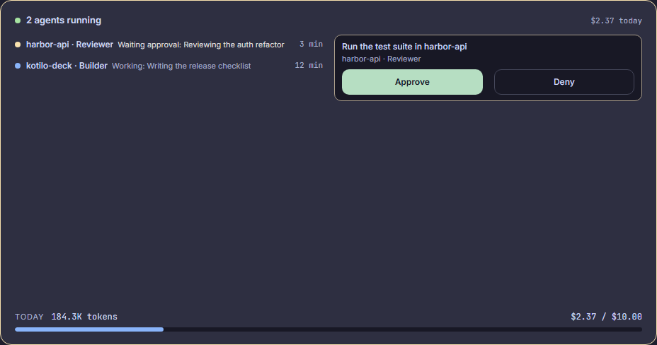 |
| Date | 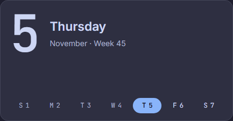 | Volume | 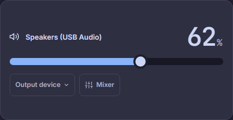 |

Every widget in all four themes, and each preset per theme, is in [docs/screenshots](docs/screenshots). They are generated by `pnpm screenshots` from a demo backend with made-up data (open `/?demo&theme=nord` in `pnpm dev` to try it).

## Install

Details and troubleshooting: [docs/install.md](docs/install.md).

- **Windows**: NSIS installer (`.exe`, per user) or MSI from [Releases](https://github.com/kotilo-dev/kotilo-deck/releases).
- **winget**: `winget install Kotilo.KotiloDeck`.
- **Linux AppImage**: download, `chmod +x`, run.
- **Linux .deb**: `sudo apt install ./kotilo-deck_*.deb` on Debian/Ubuntu.
- **Flatpak**: sandboxed build for any distribution.

## Hardware ideas

- **7" to 15" USB-C portable display** next to or below your main monitor. 1024×600 and 1920×1080 are both first-class layouts; one USB-C cable carries video and touch.
- **An old tablet or phone** in browser mode: enable *Tablet / LAN mode* in Settings and scan the QR code. No app to install.
- **Portrait mounts**: on a vertical display the grid becomes 4×8 automatically, which suits a monitor arm or a stand beside a laptop.
- A small always-on screen loves the burn-in options: turn on pixel shift and the night dim schedule.

## Keyboard shortcuts

| Keys | Action |
|---|---|
| `E` | Edit mode (move, resize, add, remove widgets); `Esc` leaves it |
| `Ctrl+Alt+K` | Show / hide the deck (global, configurable) |
| `Ctrl+Alt+←` / `Ctrl+Alt+→` | Previous / next workspace (global) |
| `Ctrl+,` | Settings |
| `Ctrl+Z` | Undo, while an undo toast is showing |

## Privacy

No account, no cloud, no telemetry. Kotilo Deck only goes online for:

- **Weather**: Open-Meteo forecast and city search, for the locations you add.
- **Calendar**: the ICS feed URLs you add.
- **Updates**: the release manifest on GitHub (daily; can be turned off).

The companion server and tablet mode listen on your machine / local network only. Settings, workspaces and todos stay in `~/.kotilo/deck/`.

## Develop

Requirements: Node 22+, pnpm 10, Rust stable, and the [Tauri 2 prerequisites](https://tauri.app/start/prerequisites/) for your OS (WebView2 + MSVC build tools on Windows).

```bash
pnpm install
pnpm tauri dev
```

| Command | What it does |
|---|---|
| `pnpm tauri dev` | Run the app with hot reload |
| `pnpm dev` | Browser preview only; add `?demo` for the in-memory demo backend |
| `pnpm test` | Frontend unit tests (Vitest) |
| `pnpm lint` | Hex-colour lint + `svelte-check` |
| `pnpm screenshots` | Regenerate `docs/screenshots` (Playwright: `pnpm exec playwright install chromium` once) |
| `cargo test` (in `src-tauri/`) | Backend tests |
| `pnpm tauri build` | Release build and installers |

## Docs

- [docs/install.md](docs/install.md): installing on Windows and Linux
- [docs/plugin-api.md](docs/plugin-api.md): writing widget plugins
- [protocol.md](protocol.md): Kotilo desktop companion protocol
- [docs/releasing.md](docs/releasing.md): cutting a release
- [SPEC.md](SPEC.md): product specification
- [docs/design/DESIGN.md](docs/design/DESIGN.md): UI design handoff
- [ARCHITECTURE.md](ARCHITECTURE.md): module map and contracts
- [DECISIONS.md](DECISIONS.md): defaults chosen along the way
- [CHANGELOG.md](CHANGELOG.md)

## License

[MIT](LICENSE)
